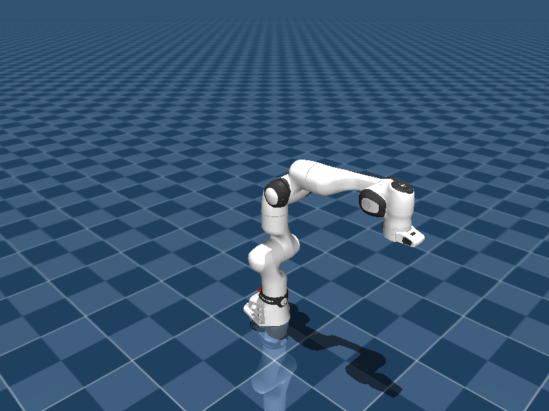
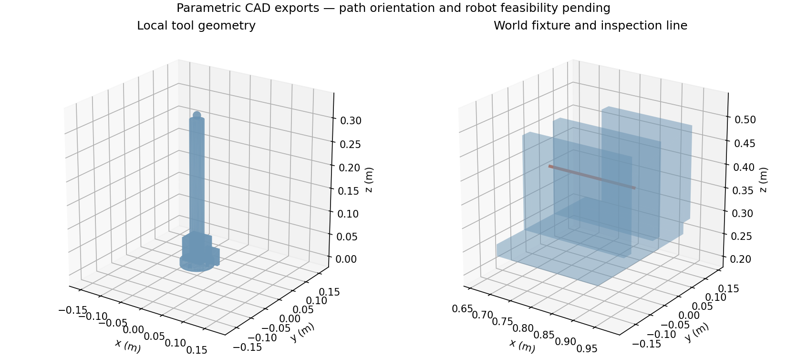
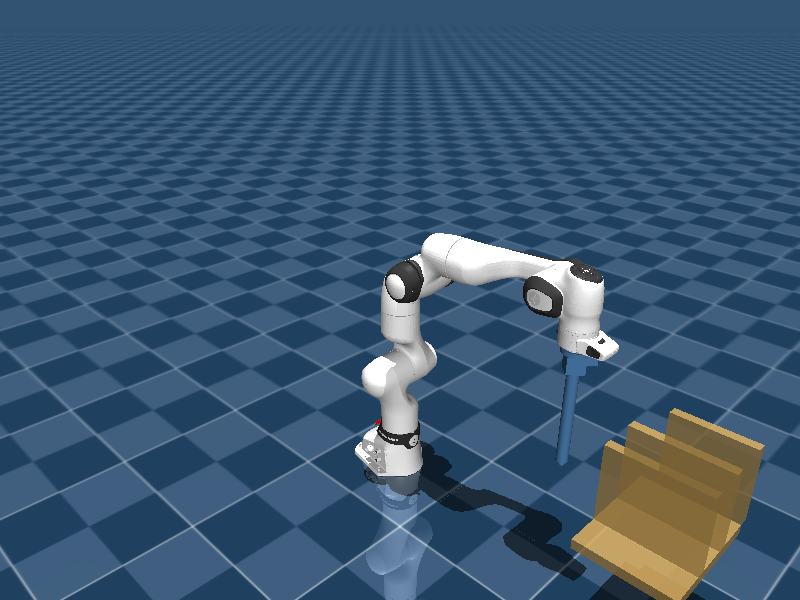
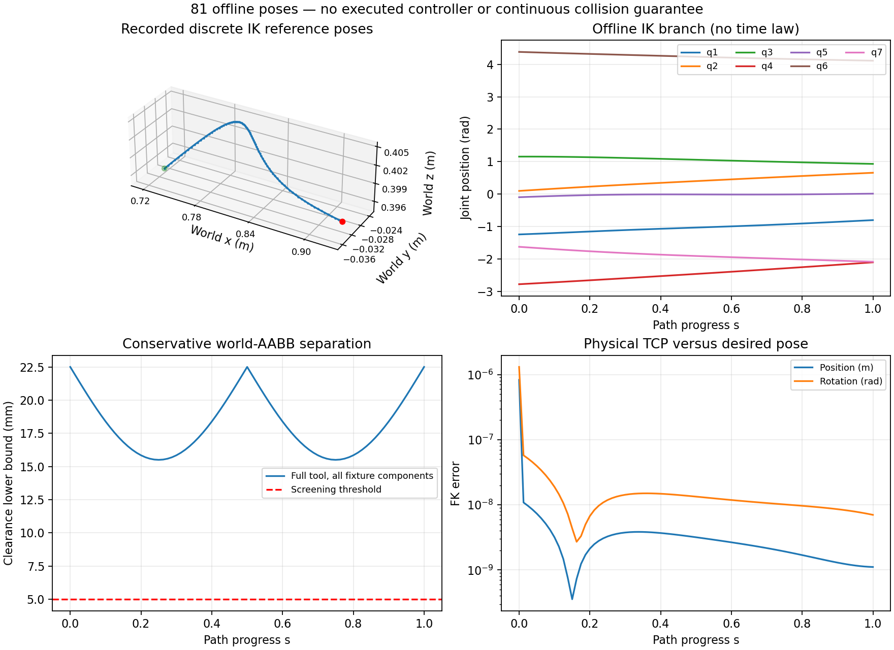
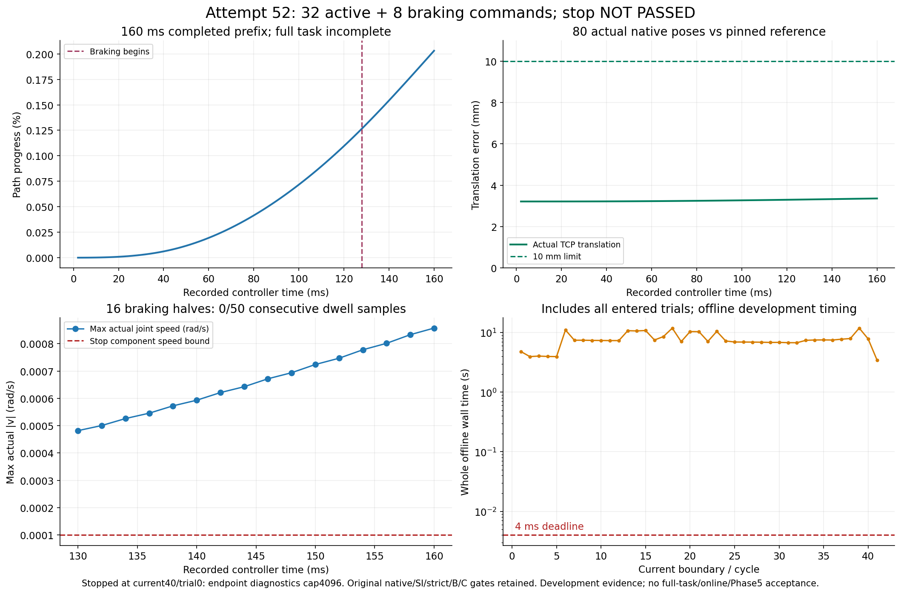

# Predictive Redundancy-Aware Motion Control

A research project investigating finite-horizon posture selection and online path retiming for 7-DoF inspection manipulators. The intended contribution is preventive constraint handling coupled to path progress, evaluated against strong reactive baselines.

**Development status: Phase0–4 component gates passed with retained failures; Phase5 is NOT_ACCEPTED and Phase6 is NOT_STARTED.** Genuine forecasts, nonlinear/geometric checks and guarded commands with two actual simulated2ms substeps are under development.

The latest longer [actual58 checkpoint](reviews/evidence/phase5_initializer58_v6_unit_v1_20261016/README.md) reaches74 committed commands/148 simulated2ms task substeps/296ms, then stops at current74/0 numeric iteration cap512. All84 braking observations fail the stop predicate, dwell0/50; all75 whole-boundary timings exceed4ms. Complete-task motion, reliable stopping and real-time control remain unproved.

The later [actual59](reviews/evidence/phase5_actual59_artifact_roster_failure_v1_20261016/README.md) retains an early integration failure after1 command/2 task substeps: a25th output exceeds the fixed24-file directory limit. Its stop-only numerical repair is not reached; whole-cycle4.701s misses4ms. Complete58 and59 stored-evidence archives are independently verified on Mac and Dell. Fresh60 merges diagnostics into one file and adds a complete-output regression while preserving the24-file limit and all original acceptance gates.

[Versioned v11](tools/phase5_controlled_stop_session_v11/README.md) repairs the saved current54/0 initializer blockage within the original finite limits. Actual58 crosses that point with the same original inputs and a hint matching the pure regression bytes. The complete58 stored-evidence archive is independently verified on Mac and Dell; older53–57 full replication gaps remain. Source/report/figure Git backup and stored-evidence recovery do not establish task or phase acceptance. [Original-channel and AC-power recovery](reviews/evidence/connection_power_recovery55_20261015/README.md) remains recorded.

Direct human instruction resumed development on2026-10-15. The earlier [offline52 failed partial run](reviews/evidence/phase5_controlled_stop_schema_match_failure_v1_20261012/README.md), its completed manual wait, verified Mac/Dell archive and all failures remain preserved.

Earlier first-cycle QP TIME_LIMIT/zero-step failures remain historical evidence in the [development record](docs/phase5_development_status.md). No predictive closed-loop advantage over Reactive QP, DLS or Servo is demonstrated. The original requirements are preserved in [docs/source/master_project_prompt.md](docs/source/master_project_prompt.md). Historical pauses, conditional diagnostics and rejected protocols remain in the evidence.

Primary platform: Ubuntu 24.04 / ROS 2 Jazzy on Dell WSL2. Primary robot: Franka FR3; planned cross-validation: KUKA iiwa 14. C++ owns runtime math/control/simulation; Python owns experiments and analysis.

- [Project specification](docs/project_spec.md)
- [Visual showcase and downloadable 3D models](docs/showcase.md)
- [Architecture](docs/architecture.md)
- [Dependency matrix](docs/dependency_matrix.md)
- [Mathematical conventions](docs/mathematics.md)
- [Issue register](reviews/issue_register.md)
- [Executed evidence and remaining acceptance work](docs/acceptance_tracker.md)
- [Paired analysis and its executed tests](analysis/README.md)
- [Phase 1 executed kinematics review](reviews/phase_1_review.md)
- [Phase 2 baseline and retained failure review](reviews/phase_2_review.md)
- [Phase 3 redundancy and executed tradeoffs review](reviews/phase_3_review.md)
- [Phase 4 constrained control, actual Servo and retained failures](reviews/phase_4_review.md)
- [Two-computer setup](COORDINATION.md)
- [Parametric CAD generation](cad/README.md) and [executed export review](reviews/cad_component_review.md)

```bash
# Ubuntu 24.04 x86_64 with ROS Jazzy already installed:
sudo bash scripts/phase0/setup_linux.sh
bash scripts/ci.sh
```

See [reproducibility](docs/reproducibility.md) and [Phase 0 review](reviews/phase_0_review.md) for prerequisites and actual evidence. An [uncached rootless Podman build](reviews/clean_component_environment_review.md) independently passed 24 actual unit cases across Phases 0–3, ROS command/state/reset exchange, 2000-sample kinematics validation and four installed consumers. Hosted GitHub Actions has executed successfully, including [run 38090687120](https://github.com/sp-zh/predictive-motion-research/actions/runs/38090687120) at checkpoint `1aa607c`. Its current scope is the baseline component inventory and statistics tests; it does not build or execute the new Phase5 standalone program or a complete predictive task. The editor devcontainer workflow and final research reproduction remain unverified. See [CI coverage and the Phase5 migration path](docs/ci-phase5-coverage.md).



The image shows the pinned upstream FR3 model running in MuJoCo; it is not an inspection benchmark or predictive-controller result. No hardware commands are enabled.



CAD geometry and source-document persistence were tested; a three-dimensional inspection curve passed 81 discrete pose and conservative full-tool clearance checks. These CAD and discrete pose tests do not establish complete-task motion or research performance; later recorded partial motion is shown below.



Physical TCP mapping and a contact-free held startup were tested. Payload inertial parameters are declared simulation assumptions; the held home pose has a conservative clearance lower bound of 0.122684 m. This held-startup result is separate from the later executed nonlinear/geometric checks and partial motion; complete-task and Phase5 acceptance remain open.



These 81 poses define a candidate 3D inspection curve with full-tool clearance checks. They do not represent executed control. [Independent collision-query audits](docs/coal_geometry_protocol.md) retain distance-query and nonsmooth-gradient failures before constrained benchmarks.



Actual80 recorded TCP poses,16 failed stop observations and41 whole clocks including the refused final boundary. The braking-mode samples remain above the stop-speed threshold; this is an incomplete160ms development diagnostic, not a successful task or real-time result. [Provenance](figures/phase5_controlled_stop_schema_match_failure_v1_20261012/PROVENANCE.json), [independent review and retained failures](reviews/evidence/phase5_controlled_stop_schema_match_failure_v1_20261012/README.md).
