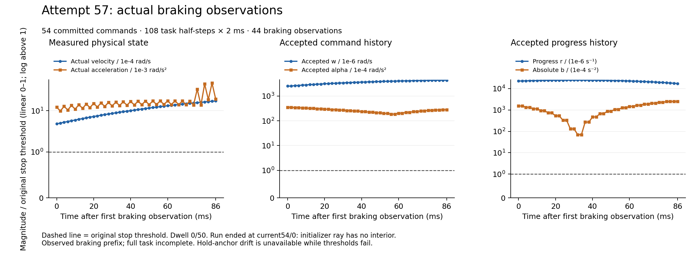

# Actual57: retained capacity repair and new initializer refusal

Fresh57 entered once under the human-authorized Dell-hot/cold, bounded-Mac
[storageV4 plan](../phase5_cold_storage_and_bounded_Mac_v1_20261015/README.md).
The original runtime source/profile/ELF and1716 input identities remain unchanged;
source v10 is the [prepared retention repair](../phase5_boundary57_prepared_v2_20261015/README.md).
No hardware or held-out experiment was run. Phase5 **NOT_ACCEPTED**;
Phase6 **NOT_STARTED**.

## Actual outcome

| Measurement | Actual57 |
|---|---:|
|Committed commands|54:32 active,22 braking|
|Actual task substeps|108 x2ms =216ms|
|Separate warmup|1000 actual substeps|
|Trials / forecasts|116 /231|
|Whole control boundaries /4ms misses|55 /55|
|Actual braking observations / stop dwell|44 /0 of50|
|Entry wall|440.595601384s|
|Session / native termination identity checks|Both pass|

The run naturally terminates at **current54/trial0**, before a hint/native
candidate for that trial, with `bounded initializer ray has no interior;
wholepolytope unknown`. Its fresh nominal Model forecast did execute; absence
of a hint does not mean no Model call. Previous committed C steps and all
original B refusals remain retained. There is no complete task, accepted
physical stop or real-time result.

Root independently verifies all731 selected payload files by size/SHA256 and
all181 complete binary artifacts by stored/raw SHA, gzip CRC, single EOF and
no trailing bytes:92,527,824 selected payload bytes,172,827,284 decoded binary
bytes. The1716 before/after input records are byte-identical. Entry and all55
whole-cycle records are decoded from the saved binaries. Every stop predicate,
anchor reset, drift and consecutive count is recomputed independently using
the original thresholds. [Root result](RESULT.json), [codec receipts](CODEC_RECEIPTS.json),
[all stop records](STOP_ROWS.json).

These are selected-packet and specified saved-data checks. They are not a
complete independent re-audit of all original QP/SI/nonlinear/B/C calculations.

## Capacity repair actually crossed

At current48/trial0 the original B value-affine/joint-trust refusal remains.
Trial1 completes its transaction with11290 measured near-boundary records,
inside the new12288 finite limit. Root independently decodes every boundary
record and verifies its original numeric domain. The first4096 records are
byte-identical to failed56. The completed hint x/y is also byte-identical to
the saved56-input pure prototype, SHA256
`8e29c022b367b5383fd2bad653df1149b564e9ea283992c68c50d11f2117f1c0`.
[Actual crossing witness](ACTUAL48_CROSSING_WITNESS.json).
The first witness-reader heredoc had a syntax error before execution; it was
corrected without modifying any input, and the error is retained in the witness
qualification. Capacity repair is a functional diagnostic result, not stop
or phase acceptance.

## Every actual braking observation

[SVG](../../../figures/phase5_stop57_actual_braking_20261016.svg),
[all44 observations CSV](../../../figures/phase5_stop57_actual_braking_20261016.csv),
[source and output hashes](../../../figures/phase5_stop57_actual_braking_20261016.json),
[renderer](../../../tools/render_phase5_stop57_diagnostic.py).
All44 records are included. Each panel has a nonnegative y scale linear0–1
and logarithmic above1, with the original threshold shown at1. Progress rate
first rises then falls; absolute progress acceleration passes through a minimum
as its sign changes. Actual velocity rises from4.81904112e-4 to1.71886488e-3
rad/s in this observed prefix. All stop predicates remain false and no hold
anchor exists. This partial trajectory does not establish the behavior of an
unobserved complete braking trajectory. It must not be shown as a successful
task video or a research comparison. The final figure was visually inspected;
the earlier draft remains in private evidence.

## Specific new refusal and next repair scope

The failed54/0 V3 initializer contains all7359 measured ray-bound rows.
Root's [full interval audit](INITIALIZER54_V3_INTERVAL_AUDIT.json) reproduces
saved lower6.573920322262719e-11 from row7358 and saved
upper7.066559503884786e-12 from row7075. Lower exceeds upper. The original
nominal maximum violation is3.5710299300939496e-11, below the declared1e-10
differential-correction scope but above the unchanged1e-12 feasible-seed gate.
Fallback scope is entered, yet no differential correction or uniform attempt
is recorded. The needed lower is below the nominal1e-6 ray cap while exceeding
the actually available upper; this identifies a concrete eligibility issue to
test on the exact saved matrices. The saved endpoints were computed in producer
binary80 and rounded to double. Root checks all saved extrema and availability,
not an independent binary80 recomputation or whole-polytope infeasibility proof.

Fresh58 development may repair this seed-preparation issue with exact fixture
bindings and bounded regressions. No58 native entry or success is implied here.
Original57 is consumed and must not be rerun or enlarged. Preserve original
1e-12/1e-10/1e-6 gates,18 free progress coordinates, non-progress bits,
finite corrections and all native/SI/B/history/two2ms/C/stop standards.

The producer's first summary import failed because its old temporary reader
module was unavailable. It restored exactly the same7289-byte reader with
SHA256 `c32178a23e5254f44ee21a62be655af3236c708c02bb061564c3d8b0b8cb468a`
from the already verified cold53 copy using no-overwrite creation. The original
absence cause remains unknown. [Failure/recovery](POSTPROCESS57_READER_DEPENDENCY_FAILURE_AND_RECOVERY.json)
is retained; only postprocessing restarted, with no second capture or native run.
Root's independent audit used the same hashed canonical reader source.

## Storage and backup boundary

Mac selected packet:
`/private/tmp/phase5_controlled_stop_boundary12288_terminal57_v1_20261015`,
READY SHA256 `af48346e100fbd09ceb58901dc7323496e6dfe3d0708a26cbd78579f90b8353e`.
The single external transport is70,943,006 bytes, SHA256
`779e8b4dc8125d1034e656e4310667ba829c5d4b23883c2f6c889f3da8abc0f1`.
Both fit the original named small-review capture limits; no reset, extra
capture, truncation or transfer expansion occurred.

Full native results remain at Dell
`/home/codextransfer/predictive_motion/results/phase5/session-controlled-stop-boundary12288-active32-brake64-dwell25-v2-20261015-attempt57`.
Uncopied native files have producer identities but no independent Mac byte
readback. This Git source/report/figure checkpoint is separate from full raw
evidence preservation. Complete new experimental-data cross-device backup
remains **INCOMPLETE**; two Dell volumes are not independent hardware backups.
