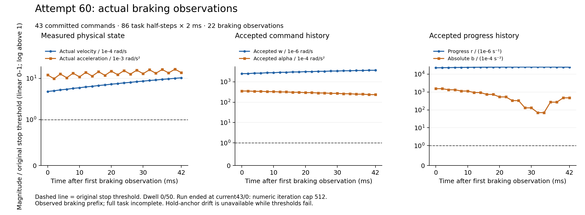

# Actual60: file-count repair crossed, new retained512-iteration failure

The original once60v2 run naturally terminates at **current43/trial0** with
`current numeric iteration cap512`. It completes **43 commands /86 actual
simulated2ms task halves /172ms**:32 active and11 braking commands. There are
92 trials and183 forecasts; the failed trial executes its nominal Model
forecast but no completed hint/nativeOSQP/B/C. All22 stop predicates fail,
dwell0/50; all44 whole-boundary timings miss4ms. Session/native termination and
1725 before/after input identities pass. Entry wall is344.140524884s;1000 warmup
steps are separate from task duration. Phase5 **NOT_ACCEPTED**, Phase6
**NOT_STARTED**; no hardware or held-out experiment.

Root independently checks all682 selected payloads (70,492,047bytes) and138
complete binary codecs (113,830,492decoded bytes), including stored/raw SHA256,
CRC and single EOF. It decodes all44 whole cycles and recomputes every stop
predicate, anchor reset and dwell using the original thresholds.
[Root result](Root/RESULT.json), [all stop records](Root/STOP_ROWS.json),
[all whole timings](Root/WHOLE_CYCLES.json), [codec receipts](Root/CODEC_RECEIPTS.json),
[saved-data auditor](Root/ROOT_ACTUAL_AUDITOR.py).
This is not a full independent re-audit of every original SI/nonlinear/B/C
calculation. Source-serialization completeness is not solver/task success.

## Actual output integration repair

Current0/trial0 retains24 complete binary receipts, including final
`cycle_timing.bin`, under the original24-file limit. The existing rank filename
contains the complete new merged V2 role, while no standalone25th chosen file
exists. Root fully decodes first-cycle timing:1C,2 task steps,2 forecasts,
complete flag1, wall4.619079581s and4ms deadline missed.
[Actual crossing proof](Root/FIRST_C0_CAPACITY_CROSSING.json).
This crosses [actual59's post-C output-count refusal](../phase5_actual59_artifact_roster_failure_v1_20261016/README.md)
in real execution, beyond the preceding synthetic24-slot test. It is an output
integration result, not a successful stop, full task or realtime result.

[Frozen v13/prepared60v2](../phase5_merged_diagnostics60_prepared_v2_20261016/README.md)
and actual entry bindings remain unchanged. The failed first60 test compilation
and the original59 failure are retained. No60 run,512/10s cap, original numerical
or physical criterion is expanded or retrospectively relabeled.

## New saved-matrix failure

The failed43/0 matrix has7344 current solver rows. Root independently extracts
H/g/A/l/u plus the V6 post-seed, yielding six-field fixture SHA256
`e8b14e198bafc29885419f2a42d54681d172b4ba1bd7f80aeca79f1044e43254`.
The separate seven-field original-nominal/D fixture SHA256 is
`0bc40bf35bb5800568c300d81a2ca673a78ff87037c5bb49b89dbbf22507992d`.
V6 completes without global fallback or differential corrections. Its non-beta
bits are unchanged; physical D displacement1.0065741944280033e-8 and independent
all-row seed violation5.464270529109694e-13 pass the original1e-6/1e-12 gates.

The incomplete hint retains all512 events and126 final ordered faces. The merged
diagnostic preserves319 rank and171 chosen-leaving records, independently bound
to old event active counts/true minimum multipliers/unchanged worst-row semantics.
No native wrapper/solve is attempted for this failing trial.
[Full binding and retained hashes](Root/FAIL43_MATRIX_BINDING.json).
This new closed-loop state is distinct from the earlier successful saved
fixtures. Their pure success does not imply convergence on every fresh state;
smallest-current-row leaving alone is not a general anti-cycling proof.

## Every actual braking observation

[SVG](../../../figures/phase5_stop60_actual_braking_20261016.svg),
[all22 rows CSV](../../../figures/phase5_stop60_actual_braking_20261016.csv),
[source/output hashes](../../../figures/phase5_stop60_actual_braking_20261016.json),
[renderer](../../../tools/render_phase5_stop60_diagnostic.py).
All points and original thresholds are shown, linear0–1/logarithmic above1.
Final actual velocity is.0010324517881226004rad/s and progress rate
.024464415244776303s^-1. No predicate passes and no hold anchor exists; zero
stored anchor drift is not a demonstrated held stop. The final figure was
visually inspected. The observed172ms segment is shorter than actual58's296ms;
this diagnostic is not evidence of a performance improvement or a task video.

## Complete stored-evidence backup on two physical machines

Selected READY SHA256
`8b75a6fdd499ef7dbe6c4b6b894234dd64a911b2c11c410b74ca20e87d46ac85`;
single transport49,072,370bytes, SHA256
`14ae15e9581dadd4f857341f6fdb05276f31fd7d9a984749b6faedc922f659c2`.
All original256/272/512MiB selected capture limits remain; no second capture.

The complete stored-evidence archive is1,933,348,287bytes, SHA256
`c50a288a6eb44a23ce25f2b2e98865267df4c62c7bfeb7fa93aa56a429d079b1`.

- Dell: `/home/codextransfer/predictive_motion/transfer/cold-archives/native60-complete-20261016-v2/complete60.tar.gz`
- Mac: `/Users/uot/Documents/ChatGPT/ros/transfer/cold-backups/native60-complete-20261016-v2/complete60.tar.gz`

Root independently restores/reads all2870 members (2866 payload files), all2112
complete native codecs (5,133,103,002raw bytes), outer CRC/single EOF and the
actual persisted Mac whole-file SHA/CRC. All85 source files match archive
manifest/runtime identities; profile and active ELF are included. Dependency/
build caches are excluded. This is complete **stored execution evidence**
recoverability, not standalone environment restoration or mathematical success.
[Full readback](archive/FULL_ARCHIVE_MAC_READBACK_AND_COPY.json),
[Mac READY](archive/MAC_ARCHIVE_READY.json),
[original Dell READY](archive/DELL_READY.json),
[independent metadata receipt](archive/METADATA_RECEIPT.json),
[bounded streaming auditor](archive/ROOT_FULL_ARCHIVE_AUDITOR.py).

The separate post-native copy preserves the4GiB part/final limit,16MiB metadata
and original33GiB free before/after; it does not enlarge the run's12GiB mode.
No native run overlaps this cold IO. Final files/directories are read-only.
The old Dell READY's Mac-pending field is unchanged; later Mac READY SHA256
`db739fe418902a184f0f030ea32c099f28d5f41861f823d7935ccd2a4af843ff`
supplies the new independent readback. Complete58/59 two-device copies remain;
older53–57 full replication gaps and environment limitations remain explicit.
Raw archives/fixtures/native ELFs stay outside Git. [Small file identities](FILES.json).

## 02:00 preparation, power and supervisor scope

The prepared source/figure checkpointea161d7 and actual-entry checkpointd6c9393
were pushed and independently matched to remote master before02:30 Toronto.
They did not claim then-unfinished native results or complete60 archives.
[Status-chat preparation receipt](preparation/STATUS_CHAT_PREPARATION_RECEIPT.json).

Read-only PowerReadAC/DC and GetSystemPowerStatus verify all four AC values0,
original DC values3600/2147483647/1/120 and ACLineStatus1. Keeper29304/wsl retains
the exact original UTC start2026-10-16T01:29:44.8524424Z and existing2222 listener.
The first helper's convenience `IdentityMatches:false` and failed assertion
are retained. A narrow follow-up proves actual/expected UTC ticks both
`639277109848524424`; the legacy `[datetime]` UTC-text cast becomes Local-kind
ticks`639277397848524424`, explaining its false comparison against UTC.
[Raw readback](preparation/LIVE_POWER_PARENT_RAW_READBACK.json),
[qualified review](preparation/LIVE_POWER_AND_PARENT_REVIEW_V2.json),
[exact UTC-ticks qualification](preparation/KEEPER_UTC_TICKS_QUALIFICATION.json).
No power, authentication, firewall, keeper or other system setting changed.

By that process snapshot, the online60 driver/native had already exited.
The earlier SSH-attached parent tree was not a demonstrated detached offline
supervisor;60 is not retroactively renamed an offline batch. No new offline
task is dispatched by this checkpoint. New61 work first needs causal saved-input
tests and finite resource/source readiness; absent a ready valuable item, only
the checkpoint is prepared. Any future actual finite offline batch must use
the reliable local supervisor and end in manualwait requiring direct human
resume. Online60's failure does not itself create that future manualwait.
