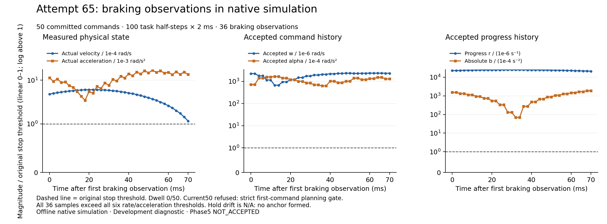

# Actual65:50 commands; retained strict-planning refusal

Actual65 enters once after the [prepared source/build checkpoint](../phase5_physical_braking65_prepared_v1_20261016/README.md), then naturally exits1 after321.600604466s. It completes **50 commands /100 actual2ms task halves /200ms**, including32 active and18 braking commands.1000 warmup halves are separate.86 trials/171 forecasts are consumed. All51 whole boundaries miss4ms. Native and session termination are verified, and all1743 startup/termination identities are byte-equal. [Independent result](Root/ACTUAL65_RESULT.json). No65 replay, extension or66 entry occurred.

At current50/trial0, the next command is rejected by **`strict current-history first-command contraction planning gate; no clipping`**. The native backend reports SOLVED/raw1 after one iteration. Root independently recomputes all14756 original SI rows and909-factor cost for first braking32, last committed49 and failed50; violations are approximately1e-13, inside the unchanged original SI gate. Failed50 has no preview, terminal-tail or forward request, so it never enters B/C or commits command51. Its actual-before state is bit-identical to last49-after. This is a stricter planning refusal, not proof of QP infeasibility. [Failed50 original SI/cost](Root/FAILED50_ORIGINAL_SI_COST_REVIEW.json).

Root independently reconstructs all seven guard intervals from actual history and the genuine new nominal. The hint is bit-identical to the last native seed and satisfies every strict-first-command check. One native iteration changes joint5 alpha from `.002308483927216515` to `.002308483927128721`, a difference of `−8.779392143831721e−14`. The resulting outward next-w exceeds its unchanged strict bound by **3.4770363671610127e−16 /3207 ULPs**. The other six joints pass. Scaled7337-row residuals are hint2.17e-17/native4.62e-13; stationarity3.40e-16/3.09e-13. The existing gate correctly refuses this saved result. No clipping, tolerance relaxation or solver/Model rerun was used to obtain this conclusion. [Independent binary64/matrix reconstruction](Root/FAILED50_NATIVE_PERTURBATION_INDEPENDENT_REVIEW.json). Earlier writer field-label qualification and every failed/superseded reader are retained.

**Stopping remains unachieved.** All36 actual braking observations fail each of physical v/a, accepted w/alpha and progress r/b thresholds; dwell0/50. Final maxima are v1.1633382065656771e-4rad/s, a1.3467988363814312e-2rad/s², w2.3080071500288625e-3rad/s and alpha.1281888600312504rad/s²; r=.020908352354853006/s and b=−.18699024607555842/s². All36 actual guard flags pass. The stored `failed=0` means no monitor structural exception, not stopping success. Hold flags are false because no below-threshold anchor forms; zero drift fields are **N/A**, not measured zero drift or36 measured drift violations. [All observations](Root/STOP_ROWS.json), [immutable-summary qualification](producer/TERMINAL65_SUMMARY_FIELD_QUALIFICATION_V1.json).

[SVG](../../../figures/phase5_stop65_actual_braking_20261016.svg), [CSV](../../../figures/phase5_stop65_actual_braking_20261016.csv), [source hashes and plot provenance](../../../figures/phase5_stop65_actual_braking_20261016.json). All36 points are shown, without selection, extrapolation or a successful-task claim. The source monitor criteria remain unchanged. This is a development diagnostic; no complete inspection-task video is available.

Root verifies all19 actual V5 nominal records, **18715 individual family records**, exact same-session baseline/current-history provenance and all18 accepted command/progress recurrences using authentic previous-candidate overlap shifts. First32 and last49 independently pass original30-state affine/qtrust/B400 geometry/sigma/acceleration/jerk arithmetic and genuine two-native2ms C contracts. Maximum affine errors are2.67e-10/4.67e-11, qtrust9.19e-5/6.55e-5 and actual-vs-value q/v errors at most2.86e-16. This does not rerun every FCL query or physics engine. [B400/C2 audit](Root/FIRST32_LAST49_B400_C2_INDEPENDENT_REVIEW.json), [all nominal/history replay](Root/ALL19_NOMINAL_HISTORY_REPLAY.json).

## Complete stored-evidence recovery

The producer streams directly from frozen Dell originals into one Mac archive, without a second Dell tar or deleting old evidence. **1,801,803,696 bytes**, SHA **`3ab9e379944389ce50233a7de6ef0fd2bbbcc9fea5708c26e1cc459b024aaaf5`**.2334 payload files/1,838,113,369 bytes plus four pinned metadata members yield2338 tar members. All2014 native codecs are source-complete, representing4,791,759,950 raw bytes. Every stored member size/SHA, certified inner raw SHA/CRC/single EOF, actual Mac fsync/reopen outer whole-file SHA/CRC/EOF, readonly rename and READY pass. Producer SENT/CONSUMED are independently read back and match the Mac receipt. Wall42.334s. [Storage checkpoint](STORAGE_CHECKPOINT.json), [actual Mac readback](archive/FULL_READBACK.json), [READY](archive/READY.json).

Copies are **Dell original frozen files + Mac complete tar on two physical devices**, not two tar files on Dell or standalone environment restoration. Mac location: `transfer/cold-backups/native65-complete-direct-mac-20261016-v1/complete.tar.gz`. Dell source remains under `results/phase5/session-controlled-stop-physical-braking-first-progress-direct-mac-v1-20261016-attempt65`. Source-complete codecs preserve this failed result; they do not make the numerical/physical task accepted. Old53–57 restoration qualifications and all earlier failures remain.

After the transfer, C free87,498,338,304 bytes is **1,756,450,816 bytes short** of the same next-run80GiB reserve+3GiB hot+128MiB external requirement. [Resource scope](AFTER65_RESOURCE_SCOPE.json). No same-layout66 entry is qualified. The project remains human-resumed for saved-data numerical robustness and explicit resource planning; this is not an invented human pause or an offline manualwait. Only the specifically approved temporary pyc cleanup was allowed, and it found0/deleted0. No frozen source, raw results, failed prefixes or backups were deleted.

Phase5 **NOT_ACCEPTED**; Phase6 **NOT_STARTED**. Physical stopping, realtime operation, complete task, hardware, heldout/main/scorer and research acceptance are not established. Daily preparation and the next actual finite offline batch's manualwait rule remain governed by the existing human instructions.
