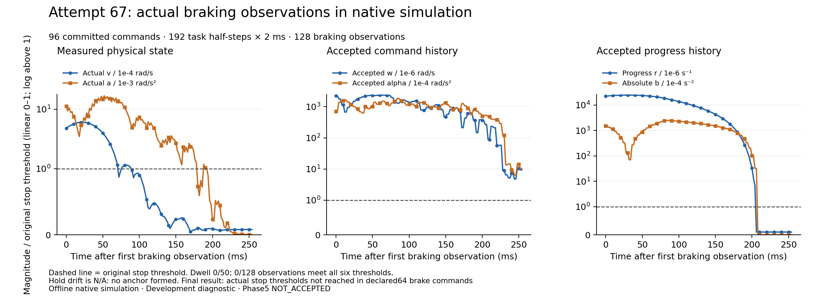

# Actual67: full declared brake window, stop still incomplete

The one-shot online run completes32active and64braking commands:96commits,192task half-steps at2ms (384ms simulated task time). The1000warmup half-steps are separate. Native wall time is497.174737314s; all96 whole current boundaries miss4ms.131trials/262forecasts remain within the original finite scope. Both native29130 and driver29129 naturally terminate, with1746 before/after inputs byte-identical and exactly matching prepared source checkpoint `c76b081d9e5945a9e4cf055b64c6fd348aad7668`.

The original error is `actual stop thresholds not reached in declared64 brake commands`. All128 observations fail the combined stop predicate, dwell0/50. No hold anchor exists: false hold flags and encoded zero drift are N/A, not drift exceedances or successful holding. The old65/66 strict numeric refusal points no longer terminate this run; this is still a retained stop failure.

| Final magnitude | Actual | Original limit | Final result |
| --- | ---: | ---: | --- |
| Physical velocity | 8.1337907865e-6 | 1e-4 rad/s | Pass |
| Physical acceleration | 3.7925881897e-6 | 1e-3 rad/s² | Pass |
| Accepted command velocity | 9.3886078678e-6 | 1e-6 rad/s | Fail |
| Accepted command acceleration | 1.0398783820e-3 | 1e-4 rad/s² | Fail |
| Progress rate | 1.0000000000e-7 | 1e-6 s⁻¹ | Pass |
| Progress acceleration magnitude | 1.1533985597e-16 | 1e-4 s⁻² | Pass |

Across all128 observations the respective failure counts are43/93/128/128/103/104. Every original guard passes. Physical near-rest alone cannot establish accepted-history stopping. The next functional question is why the present receding closed loop leaves command/history convergence insufficient inside the declared window; do not infer a fully established cause or extend consumed67.

[Independent report, reproducible sources and original writer terminal packet](RESULT_AND_BACKUP.json) preserve all128 stops,96whole boundaries,64trial0 nominal builds/62,254literal family/provenance records, and sampled first32/last95 original14756SI/909factor cost/sparse entries/B400/actual two2ms C. Both actual emitted V9 records verify140original scaled jerk interiors and the unchanged7first-command policy, original200literal history and140strict alpha checks. Sample SI violations are approximately1e-13; saved arithmetic does not rerun every FCL/physics query. Two read-only resource-limit setup errors are preserved in the report; neither entered archive arithmetic, wrote output, nor invoked a Model/solver.

[SVG](../../../figures/phase5_stop67_actual_braking_20261016.svg), [all128 CSV](../../../figures/phase5_stop67_actual_braking_20261016.csv), [provenance and renderer](../../../figures/phase5_stop67_actual_braking_20261016.json). Root visually inspected the complete figure for legibility, clipping, original thresholds, all samples,0/50 and hold N/A. This is an actual offline native-simulation diagnostic, not a successful task clip.

## Complete stored-evidence recovery

Mac archive: `transfer/cold-backups/native67-complete-direct-mac-20261016-v1/complete.tar.gz`,2,740,890,019bytes, SHA-256 `ca925ce77c1290345d3d3ce4f2b0063cc8811e7053f8b0ef3351e62c82466534`.3598tar members=3594payloads+4pinned metadata;3146complete native codecs, zero closed-failure/UNKNOWN/opaque codecs. Source payload2,787,036,839bytes. Consumer verifies every stored member, certified inner raw SHA/CRC/single EOF, fsync and actual whole-file reopened SHA/outer CRC/EOF before readonly rename/READY. Full readback SHA `20ab43e520ecdabb5ac944b6899f76020c3e8a867bcd77a4c91a52f1c6c09851`.

The original frozen source/evidence remains at Dell `results/phase5/session-controlled-stop-first-command-joint-jerk-interior-direct-mac-v1-20261016-attempt67`. These are two physical devices (Dell originals and Mac tar), not two Dell tar stocks or a standalone runtime/environment restoration. [Final independent source/SENT/1746 readback](FINAL_SOURCE_READBACK.json) is bound separately. Earlier53–57 recovery gaps remain unchanged; current complete67 backup does not retroactively close them.

The original shared derived cap1056964608bytes/10000outputs remains charged with all failures, no reset/refund. Finish this unit before allocating any fresh native68; near-exhausted output records require a concrete finite resource plan. This is not a new human pause or offline manualwait: saved-data diagnosis may continue within available bounds. Original single-writer/strict math/SI/B/history/two2ms/C/stop criteria stay unchanged. Phase5 NOT_ACCEPTED; Phase6 NOT_STARTED; no hardware/heldout/main/scorer/research acceptance.

## Saved first-step restriction and next-run resource boundary

The original writer’s [final source recheck, saved scalar diagnosis and resource plan](WRITER_FINAL_SOURCE_AND_NEXT_RESOURCE_PLAN.json) arrived after the main result checkpoint. At95, nominal protection dominates the solver half-rate bound for zero-based joints1/3; actual next-rate ratios are0.8924/1.8603. The nominal-centered first-alpha subset can exclude analytical zero-nextw alpha even where scalar originalalpha1/jerk20 permit it. This is a concrete planning restriction, not full original-QP/B/physical feasibility or an executed repair; no68 or newModel call occurred. Root preserves the exact packet and checks its scalar nextw/zero-alpha/original derivative relations against the declared limits.

Root’s fresh original-SSH disk readback finds C free86,883,373,056bytes and D free87,631,679,488bytes. Under the unchanged same-C layout, native entry requires89,254,789,120bytes, leaving a2,371,416,064-byte (about2.21GiB) entry shortfall; preparation additionally needs40MiB. No old source/evidence was deleted and original80GiB-per-volume reserves remain. The cumulative derived ledger reaches its original10000/10000output-record bound with this final documentation write (byte cap remains1056964608); no reset/refund/extra output route is used. Current evidence/reviews are complete; another native run cannot be archived under this exhausted allocation. Next work needs an explicit fresh bounded resource allocation and actual disk headroom while preserving old evidence, not replaying or lengthening67. This resource stop is not a new human pause or offline manualwait.
