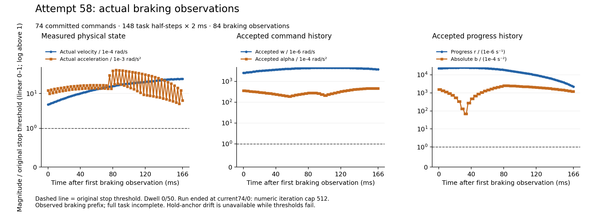

# Actual58: initializer repair, retained iteration failure and two-device archive

Fresh58 completed **74 commands /148 actual simulated 2ms task substeps /296ms**:
32 active and42 braking commands,152 trials and303 forecasts. It naturally
terminated at current74/trial0 with `current numeric iteration cap512`.
All84 braking observations fail the original stop predicate, dwell remains0/50,
and all75 whole-boundary timings miss4ms. Entry wall is587.355278971s.
The separate1000-step warmup is not task duration. Session/native termination
checks pass;1720 before/after input identities are byte-identical.
Phase5 **NOT_ACCEPTED**, Phase6 **NOT_STARTED**; no hardware or held-out run.

Root verifies all865 selected payloads (93,137,772 bytes), all221 complete
binary artifacts (170,894,680 decoded bytes), stored/raw SHA256, gzip CRC and
single EOF. It independently decodes entry/all75 whole cycles and recomputes
all84 stop predicates, anchor resets, drift and dwell from the original limits.
[Independent result](actual58/RESULT.json), [all stop records](actual58/STOP_ROWS.json),
[whole timings](actual58/WHOLE_CYCLES.json), [codec receipts](actual58/CODEC_RECEIPTS.json),
[saved-data auditor](actual58/ROOT_SELECTED_AUDITOR.py).
This is not a complete independent audit of every original B/C/SI calculation.
At failed74/0, the initializer completes but its hint exhausts512 iterations;
no native OSQP candidate, B or C follows for that trial. Its nominal Model
forecast did execute. No successful task or stop video is available.

## Actual repair and frozen source

[Versioned v11 source](../../../tools/phase5_controlled_stop_session_v11/README.md)
preserves the entire V5 initializer first. Only its no-interior refusal can enter
V6's finite full-current-uniform-interval correction. The original shared8
corrections,18 free progress coordinates, unchanged non-progress bits,
1e-10 deficit scope,1e-6 physical displacement and1e-12 all-row seed gate remain.
The computed binary80 upper is saved exactly as binary64 high plus residual;
unrepresentability refuses. Legacy scalar/correction evidence is retained;
the released legacy full row table is explicitly unavailable in the new record.
Old V2/V3 codecs, old source, rejected protocols and consumed attempts remain.

Root binds all80 frozen source files plus profile to the actual1720 runtime pins.
Profile SHA256 `bc7b819765e8c6c18111593daa16f54928a4c0f7067f349ba614297ff61a40c4`;
ELF SHA256 `14b33528c57d3ae2b1a4c1671f6c932feb6edbd2ce0ebd66f0f6c46cc5a0c4bb`.
34 compile /23 link /22 pure checks pass. Five saved initializer cases,
five old complete stop cases and six active-mode cases pass the specified
[Root source/math/compatibility review](Root/FROZEN_PRODUCTION_AND_COMPAT_REVIEW.json).
The five synthetic V4 codec cases include failures, unavailable bounds and the
maximum prefix; [full codec review](Root/V4_SYNTHETIC_CODECS_REVIEW.json) checks
exact bound pairs and availability. Initializer inventory246770<250000 and
codec679432<1MiB. Existing stop745000/global1.8B numeric and all physical/resource
limits remain. Pure harness54/0 headers are synthetic context; fixture hashes
identify cases. An inherited old56 stdout label is qualified by the actual
old57/new58 complete results in the retained production report.

Actual58 current54/0 has the same seven original QP/nominal/D arrays as the
failed57 fixture, SHA256
`601f0a92e224e024a12e56a8aaaef037fe1106377fb3e354886ac4f749c7c2e9`.
One row7358 correction, constrained by row7075, has physical displacement
1.2442612996843024e-10 and seed violation6.813438702124586e-13.
The completed173-event hint x/y matches the pure result byte-for-byte,
SHA256 `aad3b819cd4eb17dc8c4745b2aef83135d1814ff94729d69a0dada12ce384936`.
Independent NumPy final violation3.504748574689742e-13 and
stationarity2.1684043449710089e-16 pass the unchanged numerical gates.
This crosses that concrete blockage; it does not establish task/stop acceptance.

Root's first saved-data audit wrongly assumed successful `solver_seed` still
equaled the original nominal. Production replaces it with the completed hint.
The corrected audit verifies hint equality and reconstructs nominal separately;
the [reader failure and correction](actual58/READER_FAILURE_QUALIFICATION.json)
remain recorded. No native run or capture was repeated.

## All actual braking observations

[SVG](../../../figures/phase5_stop58_actual_braking_20261016.svg),
[all84 rows CSV](../../../figures/phase5_stop58_actual_braking_20261016.csv),
[source/output hashes](../../../figures/phase5_stop58_actual_braking_20261016.json),
[renderer](../../../tools/render_phase5_stop58_diagnostic.py).
All points and original thresholds are shown; the y scale is linear0–1 and
logarithmic above1. Final progress rate is.002217349344098695 s^-1, but actual
velocity is.0026060903890309907 rad/s and the full stopping trajectory remains
unobserved. The final figure was visually inspected. Zero recorded drift means
no hold anchor existed while thresholds failed, not a demonstrated held stop.

## Entry and archive scope

Entry was once at2026-10-16T04:48:47.020916Z, driver6792/native6793.
[Actual plan/entry qualification](Root/EXECUTED_PLAN_AND_ENTRY_REVIEW.json)
preserves the executed storage plan SHA82d2a941…, distinct from Root's unexecuted
later draft7cf43b51…. Enforcement and all original caps agree; no plan was
retroactively replaced. Full raw data stayed on Dell during the run; selected
payload256MiB/extracted272MiB/single transport512MiB and the shared derived
budget remain. The selected packet READY is
`80afd6ecffd138417a78ea1fab50ccc19663e7f8e2d88c04132c4dfbe52cb7ba`.
Its70,752,308-byte transport SHA is
`914b5fa3e139d65832dada731f438467354e5ef8d03a8ca0f5ac7a51ab4bad39`.

After native termination, newly available Mac space permitted a separately
bounded4GiB archive copy with16MiB metadata and the original33GiB free-space
requirement before/after. The cause of the preceding free-space increase is
unknown; no additional cleanup occurred. This does not enlarge the run's
original12GiB bounded-review mode or single selected capture.

The complete58 stored-evidence archive is3,225,158,075 bytes, SHA256
`12408b223543570a2e92fe912bddb5525d49645bec71c38631f4b069e8ff0fb5`.

- Dell: `/home/codextransfer/predictive_motion/transfer/cold-archives/native58-complete-20261016-v1/complete58.tar.gz`
- Mac: `/Users/uot/Documents/ChatGPT/ros/transfer/cold-backups/native58-complete-20261016-v1/complete58.tar.gz`

Root independently reads all4405 tar members by size/SHA and all3496 inner native
codecs (8,553,770,397 decoded bytes), checks outer CRC/single EOF, fsyncs then
reopens the actual Mac file for whole SHA/CRC before atomic rename/read-only
publication. [Mac READY](archive58/READY.json),
[full independent readback](Root/FULL_ARCHIVE_MAC_READBACK_AND_COPY.json),
[post-native plan](Root/POST_NATIVE_MAC_BACKUP_PLAN.json).
Frozen80 source files, profile and active ELF are included; only dependency/build
caches are excluded. This corrects the ambiguous exclusion sentence in the
immutable Root readback report. The original [Dell READY](archive58/DELL_READY.json)
still says Mac readback pending; the later separate Mac proof closes it without
rewriting that historical file. Mac READY SHA256 is
`403578a7bade89048051d0702f683c1dd14c050ba45febf1c9d5387b14515dd0`.

These are two verified physical stored-evidence archive copies, not a standalone
environment restoration or phase acceptance. Older53–57 complete cross-device
replication gaps remain. Raw archives/fixtures/native ELFs stay outside Git;
this checkpoint publishes source, reports, small provenance and actual figures.
[Initial copied-file manifest](FILES.json), [additional files](MILESTONE_FILES.json).

The temporary stop-authorization confusion is [explicitly qualified](Root/HUMAN_AUTHORITY_CHRONOLOGY_QUALIFICATION.json):
the stop was Oct8 history, followed by direct resumes including the current
Oct15 instruction. No new human pause was issued.59 cause-based stop-only
leaving-policy development continues with fresh finite checks; no59 native
entry is established by this checkpoint. Preserve all standards and failures.
