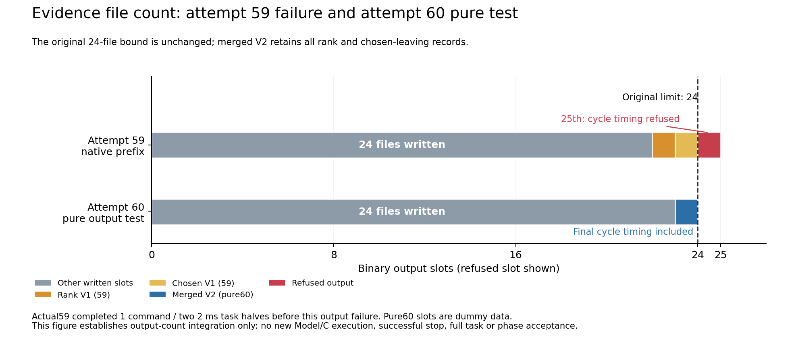

# Prepared60 v2: complete diagnostics within the original24 output slots

This completed source/regression unit repairs [actual59's retained post-C
file-count failure](../phase5_actual59_artifact_roster_failure_v1_20261016/README.md).
It is not a native60 outcome. Phase5 **NOT_ACCEPTED**, Phase6 **NOT_STARTED**;
original hardware/held-out/main/scorer boundaries remain.

Fresh60v2 subsequently entered once at2026-10-16T05:56:01.556607Z (Toronto01:56).
[Root actual-entry binding](entry/ACTUAL_ENTRY_BINDING_REVIEW.json) independently
checks the actual runtime plan SHA7881fc625bde535894ea2939b91d4eb7598e09d3aa17b8eae0be4f2511ff1028,
all85 frozen Git source files, profile/ELF and1725 input records. Entire
prepared/actual parsed plans agree; original resource/capture limits remain.
Its05:59:30Z observation has no terminal record. Native result/full new
stored-evidence backup are pending. [Entry metadata qualification](entry/ENTRY60_METADATA_SCOPE_QUALIFIER.json)
preserves the original scope sentence's old `fresh59` literal, qualified by
actual60 schema/v2 paths/input hashes, without rewriting ENTRY or rerunning.
[Entry copied files](ENTRY_FILES.json). This is online continuation, not a new
offline manualwait or a successful stop/task result.

[Frozen v13](../../../tools/phase5_controlled_stop_session_v13/README.md) replaces
the existing `hint_kkt_rank_events.bin` with an explicit
`CONSISTENT_SINGULAR_ACTIVE_FACE_KKT_AND_STOP_SELECTED_LEAVING_DIAGNOSTICS_V2`
format containing **all** old rank and new chosen-leaving fields. It removes
the separate25th native output without dropping records or increasing the
24-file limit. Original V1 rank/V59 chosen formats and all prior source/failures
remain unchanged. The canonical24-entry reader remains unchanged.

Root verifies84 source-manifest entries (85 files including manifest).
Only main output/profile integration, README/manifest and two new codec/test
files differ from59. `current_numeric_guess.hpp`, leaving helper, full QP and
evidence24 implementation are byte-identical to59. Profile changes are limited
to fresh session ID and explicit new codec/file. Original512/10s,745000/global
1.8B, native/SI/nonlinear/geometric/B/history/two2ms/C/stop gates remain.
Conservative merged bound512×32+512×48+4096=45056bytes<1MiB; static raw/stored
terminal bounds remain below32MiB. The retained numeric inventory remains
744208<745000. This is output integration, not a new optimizer method.

## Real failed first source version

The first60 source version compiles units1–35, then unit36's test fails because
the generator globally replaced `ROSTER`, inserting quoted file names inside
two C++ role/stage string literals. Root independently reads all original
failure reports/stderr and verifies35 exits0 followed by exit1, runtime0,
unchanged before/after inputs and no native ENTRY/run directory.
[Failure cause](Root/COMPILE_V1_CAUSE_REVIEW.json),
[original reports index](Root/FAILED_V1_READBACK_INDEX.json),
[bad frozen test](failed_v1/merged_hint_diagnostics60_tests.cpp),
[its source manifest](failed_v1/SOURCE_IDENTITIES.json).
V2 corrects just those two test literals plus manifest and uses a fresh profile/
session. All other source bytes match failedv1; no consumed59 run is repeated.
The failed source/test/compiler evidence remains intact.

## Verified pure output integration

V2 completes36 compile commands,25 link targets and24 pure tests, all exit0,
with before/after input identity bytes equal and no Model/native runtime calls.
Root independently verifies110 pure payload hashes and fully decodes:

| Pure codec case | Rank records | Chosen records | Raw bytes |
|---|---:|---:|---:|
|Maximum|512|512|42267|
|Active/no stop policy|512|0|17691|
|Unavailable hint|0|0|1307|
|Full24-name output chain|512|512|42267|

All fields, CRC/EOF and stored/raw SHA are checked. The complete24-name order
is independently bound to sealed actual58's successful trial0 manifest,
SHA256 `f398787ea00a8350056196898b5292b736071e4d0eeb164b3a93c2d8f8919525`.
The pure test runs that output order through the original Evidence writer,
reaches final `cycle_timing.bin`, retains24 complete binary receipts, and still
refuses a25th standalone chosen file before creating it. Other slots contain
explicit dummy data: this checks the output/count pipeline, not Model/C behavior.
[Root full codec/output-chain review](Root/PURE24_MERGED_AND_FULL_ROSTER_REVIEW.json),
[frozen roster](FROZEN_SUCCESSFUL24_ROSTER_BINDING.json),
[source/roster review](Root/SOURCE_AND_ORDERED24_ROSTER_REVIEW.json),
[compile/link readback](Root/V2_BUILD_LINK_REVIEW.json).

## Formal saved-input compatibility

Root independently verifies118 formal-production payloads and17 driver exits0.
All seven saved stop cases pass original full-row primal≤1e-12 and stationarity
≤1e-10 gates. All previously saved59 x/y, events, boundary records, endpoints,
refinements and full endpoint stream bytes match exactly. All six activefalse
complete serialized cores also match59 byte-for-byte.

| Saved stop case | Hint iterations | Rank records | Chosen records |
|---|---:|---:|---:|
|actual56/48/1|272|264|8|
|old52/40/0|216|137|12|
|old53/40/1|201|139|13|
|old54/43/0|196|134|13|
|old55/40/2|162|0|13|
|actual58/54/0|167|154|29|
|actual58/74/0|171|163|50|

Within each **same Result from one derive call**, the harness serializes legacy
rank, legacy chosen and merged format. Root compares every record byte and
binds rank dimensions/chosen multipliers to old current events. Legacy chosen
raw bytes additionally match the prior saved59 output. Prior59 formal tests
did not separately save independent raw rank arrays; no comparison against such
nonexistent arrays is claimed. Same-Result formatter comparison is not an
independent reconstruction of every eligible working set or a convergence proof.
No additional solver/Model call is made just to produce the legacy format.
[Formal independent review](Root/FORMAL7_STOP6_ACTIVE_MERGED_REVIEW.json).

## Diagnostic figure and execution boundary

[SVG](../../../figures/phase5_output_roster59_60_20261016.svg),
[CSV](../../../figures/phase5_output_roster59_60_20261016.csv),
[provenance](../../../figures/phase5_output_roster59_60_20261016.json),
[renderer](../../../tools/render_phase5_output_roster60.py).
The red slot is the refused output, not a file that exists. Gray counts differ
because59 lacks cycle timing while the pure60 chain includes it. No new motion,
physical stop or task completion is represented. The first draft had overlapping
and clipped labels and remains privately retained; the corrected final was
visually inspected. [Visual copied-file record](VISUAL_FILES.json).

Root's first pure-reader script had an invalid Python identifier and failed
before imports/reads/writes. Its correction and narrow scope are retained in
the Root report; no pure/native/capture was repeated for that reader error.

Fresh60v2 actual entry and outcome require separate immutable records under
the existing continuous work-package rules. No new human/Git gate is created
by this checkpoint. It publishes only source, small reports and an integration
diagnostic; raw fixtures/native ELFs/build caches are excluded.
[Copied identities](FILES.json). Verified complete58/59 stored-evidence Mac/Dell
archives remain separate, with older replication gaps and environment-restore
limitations unchanged. None of these preparation/backup results passes Phase5.
