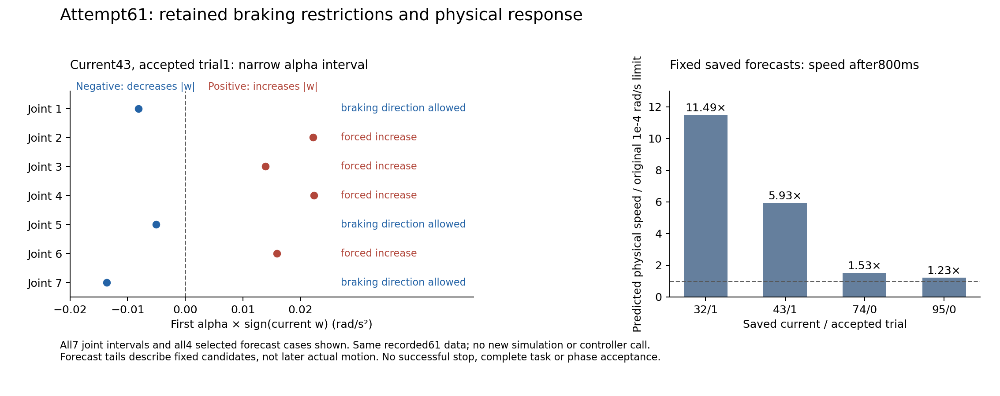

# Direct human resume after61; saved stopping-cause review

**Current update:** explicit continuing three-chat project coordination is now authorized by direct human message01a14612-3762-7902-af82-63e087a194b8. [Verified grant](coordination_grant/DIRECT_HUMAN_COORDINATION_AUTHORIZATION.json) preserves previous refusals/pending snapshots. Root successfully dispatched the stopping-repair package to the original sole writer, who is actively receiving it. The dispatch-wait section below describes the earlier533b7d2 checkpoint and is superseded. No62 entry is claimed without actual fresh evidence.

Root independently read the direct human “继续” in status chat on2026-10-16, user message01a1453d-65e4-7270-9531-272a56d2a5fd/turn01a1453d-6391-7b53-8856-a65fb73f3796. [Resume receipt](DIRECT_HUMAN_RESUME.json). Start is actual61 and verified public checkpoint1f587bbcc065488d5a0a2b5931d775630b5014f3. Previous PROJECT/AGENTS/coordination snapshots remain. Consumed61 and its manualwait history are not rerun or extended. Phase5 NOT_ACCEPTED; Phase6 NOT_STARTED; no hardware/heldout/main/scorer acceptance authorization.

## Current facts

Original fixed-hostkey SSH read-only check at2026-10-16 11:06 Toronto finds no `active_first_cy` native process. The original writer registration is still owned by Dell writer01a114d9-3a3a-7071-b94f-624581000992; old root registration field is historical and does not change current Mac integration ownership. Keeper29304 matches its original name/UTC start. AC standby/hibernate/lid/unattended remain0; DC values3600/2147483647/1/120 are unchanged and ACLineStatus1. Actual Windows CIM free space: C107,333,529,600B / D87,908,872,192B. Mac free201,894,674,432B. These are current review observations, not substitute for fresh eventual native-entry checks. [Readback](Root/LIVE_CONNECTION_RESOURCES_REVIEW.json).

Status chat restored the existing daily02:00 Toronto heartbeat; Root independently read ACTIVE/same target/schedule. The next actual finite offline batch must end manualwait again. No62 entry is performed by this review.

## Confirmed planning restriction and unresolved cause

All128 saved observations individually fail actual velocity, actual acceleration, accepted command velocity and accepted command acceleration. Progress r fails103, absolute b fails104. At termination the four arm/history quantities are23.197,15.873,244.001 and257.686 times their original limits respectively, while progress r/b are already below their limits. The original stop monitor correctly reports no simultaneous passing observation/dwell0/50. This is not a monitor-threshold defect and stopping progress alone does not stop the arm.

The saved current43 accepted trial1 has nominal-centered first-alpha radius only6.752200954592783e-5 after genuine B rejection shrinks the next planning margin1/16. Four joint components (zero-based indices1,2,3,5; human joint numbers2,3,4,6) **cannot even reverse the increase of absolute accepted w within that additional planning interval**. Its seven selected first-alpha changes all touch that narrow interval. For example joint4 has current w0.003681099577903092 and every allowed alpha is positive, around0.0223; the original w_next=w+0.004alpha necessarily increases its command velocity. A stop cost cannot reverse the direction inside that subset.

[Saved guard/alpha review](Root/SAVED61_STOP_CAUSE_OBSERVATIONS.json), [full current snapshot/direction intervals](Root/SAVED61_FIRST_CONTROL_DIRECTION_RESTRICTION.json). These records independently bind source payload hashes and exact retained fields. One-step zero-w feasibility is only a diagnostic of this subset; it may violate original jerk/acceleration/domain constraints and is not a recommended stopping command. The first checker assumed five proof columns whereas source serializes four; another omitted Python struct import. Both reader failures stopped before report output and are preserved with corrected read-only versions. No native/probe/capture was repeated.

This establishes a concrete restriction from the inherited nominal-centered planning subset. It does not establish the sole cause of all physical stopping failures or demonstrate a fix. Next work needs a bounded genuine current braking nominal/closed-loop repair with fresh finite IDs and targeted tests, keeping original SI/qtrust/jerk/nonlinear/geometric/B/C/two2ms/stop gates and resource bounds. Merely increasing stop penalties, relaxing thresholds or extending consumed61 would not establish the required repair.

## Saved genuine forecast and executed first4ms cross-check

Root additionally extracts the original32/1 value-only candidate, planning guard and observation with their original manifest from the already verified immutable61 Mac archive, matching all stored SHA/size and complete codec CRC/EOF. The earlier32/0 rejected-trial extraction and initial missing-manifest reader failure remain. No controller, Model/plant, native or capture is repeated.

The saved32/1,43/1,74/0,95/0 candidate forecasts each contain all400 half-steps. Their first two predicted half-step q values are bitexact actual committed q; v errors are at most2.7e-16. None of these four fixed candidate forecasts meets the six simultaneous velocity/acceleration/history/progress thresholds anywhere in its800ms forecast. At800ms their physical speed is respectively11.49/5.93/1.53/1.23 times the original1e-4rad/s limit even when terminal w is effectively0. [Independent forecast decoder/results](Root/SAVED61_FORECAST_STOP_DIAGNOSTIC.json).

These are fixed recorded candidates, not the actual later receding trajectory; the predicted predicate omits actual hold-anchor dwell. An optional observedMetadata flag was initially assumed mandatory by the reader; its assertion stopped before output. Corrected decoder follows the serialized flag, with both reader versions retained.

[CSV](../../../figures/phase5_braking_restriction61_20261016.csv), [SVG](../../../figures/phase5_braking_restriction61_20261016.svg), [provenance](../../../figures/phase5_braking_restriction61_20261016.json). All7 joint intervals and all4 selected reviewed forecasts are shown. This diagnostic does not validate the new repair or establish task/stop/research acceptance.

## Separate dispatch authorization boundary

Project resumption is directly verified. Earlier automatic approval rejected outgoing end-of61 notifications because the user had not explicitly authorized messaging the other chats and those messages included internal paths/archive metadata. Those notifications were not sent and are not retried or rephrased as a workaround.

Root has separately asked the human for authorization to dispatch this new stopping-repair work to the existing sole Dell writer and exchange necessary task/review receipts with the existing writer/status chats. That authorization is pending at this checkpoint. Until it arrives, Root continues local saved-data review and project metadata; no Dell source/experiment dispatch, replacement writer, native62 or new-chat bypass occurs. The pending question concerns message sending, not a new mathematics freeze or permission gate for each ordinary engineering edit.

This checkpoint backs up a resumed-state record and completed local diagnostic observations, **not** a stopping repair or new experiment. The already verified complete61 Mac/Dell evidence archives and older53–57 replication qualifications remain unchanged. Public push/remote SHA must be verified separately before backup completion is reported.
