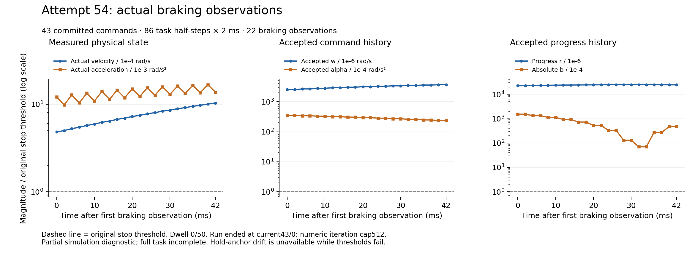

# Online attempts 53–54 and prepared refinement 55

Direct human “继续推进项目” resumed the project on 2026-10-15. Root verified
message `01a14153-949c-7f33-953a-22d7126b69e8` in the status chat. The original
offline52 manual wait and every failed run remain preserved. These are online
development attempts within the resumed work package. Phase5 is NOT_ACCEPTED;
Phase6 is NOT_STARTED.

| Attempt | Actual committed prefix | Stop observations / dwell | Terminal result |
|---|---|---|---|
| 53 | 40 commands, 80 × 2 ms task halves, 160 ms | 16 / 0 of 50 | current40/1: near-boundary diagnostic capacity1024 |
| 54 | 43 commands, 86 × 2 ms task halves, 172 ms | 22 / 0 of 50 | current43/0: numeric iteration cap512 |
| 55 | None: native entry not consumed | Unavailable | Prepared and tested; SSH banner timeout before preentry completed |

The 1000 bootstrap/warmup steps are separate from task halves. All 41/44
whole-boundary timings in 53/54 exceed4ms, including their failed boundaries.
Neither run completes its task or demonstrates reliable stopping or real-time
operation. The original SI, nonlinear/geometric, trust, accepted-history,
two2ms physical-step and stop thresholds remain unchanged. No hardware or
formal held-out experiment was authorized.

53 replaced the old4096 endpoint-record limit with lossless16384 records under
an unchanged700K stop numeric precharge and1.8B global limit. Its current40/0
passed the former cap, then original B checks refused a candidate and40/1
relinearized. 54 conservatively charged all4096 near-boundary records within
the same budget; current40/2 passed original B and actual C, crossing the old
failure point. Full ordered records were retained; a lossy draft was not deployed.

## Diagnosed iteration loop and candidate failures

Exact saved54 current43/0 probes repeat complete primal, faces, solve vectors
and dropped-mask arrays at iterations195/197. A129-face rank-deficient KKT
solution removes(7236,-1); the128-face solution has direction infinity norm
1.343620744e-12, just above the unchanged1e-12 gate. Its tiny negative boundary
slack(-3.46944695e-18) produces a zero path fraction and reintroduces that face.
Root independently measured rank128 and a3.49e-15 span reconstruction error.
Mixed-sign span coefficients do not prove a redundant inequality.

The ordinary-drop-mask candidate failed512 iterations again, moving the loop
to row7255. It is retained in `MASK_ONLY_NEW_TAIL_DIAGNOSIS.json` and is not in
the deployed source. Increasing the512 iteration limit was not used as a fix.

[Versioned v8 source](../../../tools/phase5_controlled_stop_session_v8/README.md)
adds stop-only KKT iterative refinement: same original double FullPivLU,
initial residual/rank/positive-Hessian gates first, then at most3 corrections
using that decomposition and extended-precision residual accumulation.
Corrections above max(1,old solution infinity norm), nonfinite values or
non-improving residuals are refused without clipping. Final original residual,
direction, feasibility,512 iterations and10s gates remain. Active mode does not
enable refinement. The V2 codec explicitly records bounded availability,
reasons, residual changes and correction caps.

Root independently checks all three production-math fixtures40/0,40/1,43/0:
original primal1e-12 and stationarity1e-10 gates pass. Activefalse outputs match
the old source byte for byte on those inputs. Dell additionally reports30
compiled units,19 linked targets,18 stable-input pure tests and bit-equal
interior/boundary/zero active cases. Native build/test logs remain on Dell;
these counts do not establish actual55 execution. Maximum codec shape is
3,507,749B<4MiB; inventory691856<700000; original global worst-case accounting
1793026160<1800000000 and32MiB terminal reserve are retained. Source/profile
and intended1711 distinct runtime identities are in `PREPARED55_INDEX.json`.

## Actual figure and review scope

[CSV](../../../figures/phase5_stop54_actual_braking_20261015.csv),
[SVG](../../../figures/phase5_stop54_actual_braking_20261015.svg),
[provenance](../../../figures/phase5_stop54_actual_braking_20261015.json),
[renderer](../../../tools/render_phase5_stop54_diagnostic.py).
Every22 recorded braking half is plotted, with logarithmic threshold ratios;
separate panels have independent y scales. Hold drift is unavailable while
the threshold predicate is false; its stored zero placeholders are not
measurements of zero drift. The initial figure layout failed visual inspection
and is retained under the v1 temporary output; the shipped v2 was inspected
for labels, legends, units and clipping. The renderer uses an isolated local
Matplotlib3.10.3 dependency target; no system or simulation environment changed.

`root_RESULT.json` independently verifies the selected54 packet's502 payload
size/SHA identities and parses all44 whole cycles and22 stop observations.
Root's numerical reports separately check saved pure results and active-row
linear dependence. They do not certify every original/reduced QP, nonlinear
forecast or geometry query in53/54; the complete52 review remains separate.

## Connection and backup limits

The SSH banner failure occurs before55 preentry can authenticate. ARP and
TCP2222 remain reachable; the current WSL/keeper state is unknown. The prior
connection repair's WSL-stopped diagnosis is not asserted for this recurrence.
The existing Dell maintenance host also returned app-server unavailable.
Status chat requested that the human open Ubuntu on Dell and keep it open.
Resume fresh resource and1711-input identity checks under a new preentry name
after real login and bidirectional transfer verification. No new human
project-resume authorization is needed for this online continuation.

This public source/review checkpoint preserves recoverable progress while the
external connection is unavailable. Full experimental evidence backup remains
incomplete until its new Mac/Dell archive/readback work is completed. See
[storage identities](STORAGE_CHECKPOINT.json). Git publication does not change
the stop/full-task/phase results. The old196bf49 connection checkpoint and
accepted Phase0–4 evidence are preserved.
