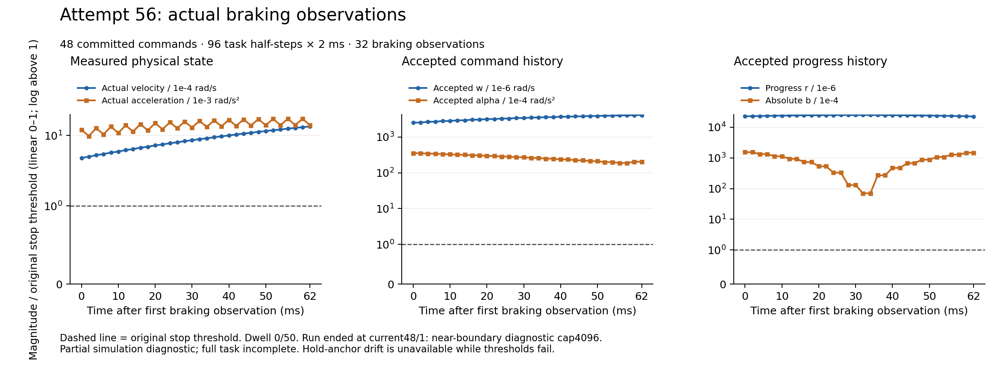

# Actual55–56 continuation and bounded initializer repair

The original connection and AC-power recovery is recorded separately in
[recovery55](../connection_power_recovery55_20261015/README.md). These are online
continuations of the human-resumed functional work package. No offline batch,
hardware run or phase acceptance is implied.

| Actual run | Committed commands / actual task halves | Failure | Stop dwell | Whole-boundary 4 ms misses |
|---|---|---|---|---|
|55|40 / 80 = 160 ms|current40/2: bounded initializer ray has no interior; whole-polytope status unknown|0/50|41/41|
|56|48 / 96 = 192 ms|current48/1: near-boundary diagnostic record cap4096|0/50|49/49|

Warmup1000 physical steps are separate. Run55 has87 trials/173 forecasts;
run56 has104 trials/207 forecasts. Both session/native termination checks pass;
neither completes the task or physical stop. All failures and original sources
remain retained. Later diagnostic progress does not establish controller quality.

## Repair and verification scope

At actual55 current40/2, a violated adjacent row has nonzero uniform-ray travel
2.77555756156e-17. Its needed uniform parameter exceeds1206, while the declared
cap is1e-6. This is numerical ray failure, not a whole-polytope infeasibility
certificate. The original V4 initializer and original uniform helper remain.
The versioned V5 fallback makes at most8 bounded row corrections in only18 free
progress inputs, with unchanged1e-10 deficit,1e-6 physical step/total-delta and
1e-12 full-row gates. Non-progress coordinates retain their exact bits. Failed
and unapplied corrections retain availability flags and errors in the explicit
V3 initializer codec. No original affine/SI/nonlinear/geometric/B/C/stop gate changes.

The exact73-file source snapshot and profile are in
[session_v9](../../../tools/phase5_controlled_stop_session_v9/README.md).
Dell reports31 translation units,20 links and19 stable pure tests passing.
The initial pure-harness include-path compile failure and the Mac long-double
decoder mismatch remain retained; neither was repaired by changing production
math or relaxing comparison tolerances. Root independently checks three old
fixtures and the actual55 failure fixture against original matrices, D scales,
nominal seeds, final residuals and full V3 codec structure. The earlier report
named FOUR_CASES contains only three old cases; it is preserved and corrected
by [FOUR_CASES_V2](initializer_PRODUCTION_FOUR_CASES_V2.json). Pure harness V3
contexts use40/2 for all cases; external fixture bindings identify the actual
old cases, as explicitly [qualified](initializer_V3_PURE_CONTEXT_QUALIFICATION.json).

Root verifies all537 selected55 payload hashes and151 complete gzip/raw hashes;
all694 selected56 payload hashes and211 complete gzip/raw hashes also pass.
Actual56 entry/whole-cycle counts are independently decoded from saved binaries.
Its1713 startup/termination identity records are byte-identical. All source
manifest entries and the separate profile SHA256
`75cc30ee32d2bc508816690359c9fc1b24853f18467cf1975499d2d9dc561338`
are independently checked against the canonical Mac copy.
[Root55 result](ROOT55_ACTUAL.json),
[Root56 packet audit](ROOT56_PACKET_SHA_RESULT.json),
[codec audit](ROOT56_CODEC_RESULT.json),
[actual counts](ROOT56_ACTUAL_COUNTS_RESULT.json).
These are selected-packet checks, not a full independent QP/SI/B/C audit.

## Actual braking observations

[SVG](../../../figures/phase5_stop56_actual_braking_20261015.svg),
[all32 observations](../../../figures/phase5_stop56_actual_braking_20261015.csv),
[provenance](../../../figures/phase5_stop56_actual_braking_20261015.json),
[renderer](../../../tools/render_phase5_stop56_diagnostic.py).
All32 observations fail original stop thresholds. Actual velocity rises from
about4.82e-4 to1.34e-3 rad/s; this is adverse evidence, not improved braking.
Panels use a nonnegative scale linear from0 to1 and logarithmic above1.
An initial layout with unnecessary negative symlog ticks remains in private
evidence; the delivered figure was corrected and visually inspected. There is
no accepted Phase5 task video.

## Cause of the next diagnostic limit

The exact actual56 current48/1 saved fixture has A7346x144. An8192-record pure
candidate still exhausts capacity and is retained. A separately bounded65536
diagnostic probe completes in272 numeric iterations with11290 boundary records,
15812 endpoint records and264 rank events. Its first4096 boundary records and
old failed partial x/y match actual56 byte for byte. Root independently computes
primal violation7.89293977399e-13 and stationarity1.11022302463e-16.
This is saved-matrix arithmetic, not a new native/B/C result.

The prospective12288-record version needs741008 numeric slots, below a745000
stop-trial precharge. Only cycles>=32 use stop mode; reaching them requires at
least32 active trials, leaving at most144 of176 global trials in stop mode.
Thus the conservative prospective whole bound is1799506160<1800000000,
with493840 slots remaining. The65536 probe inventory is not deployable under
this bound. [Independent arithmetic and byte bindings](ROOT56_PURE57_CAUSE_RESULT.json).
Fresh57 implementation/regression and entry are separate from this actual56 result.

## Storage and backup boundary

Selected55 Mac packet:
`/private/tmp/phase5_controlled_stop_kkt_refinement_terminal55_v1_20261015`,
READY SHA256 `05f3141a28e3a5988d60bf1e0b98a9a48dbef0e0d12327218c3abf4fcb2afebc`.
Selected56 Mac packet:
`/private/tmp/phase5_controlled_stop_row_initializer_terminal56_v1_20261015`,
READY SHA256 `912e2fb5c6479b20f404eb9f0722d799c67fa59016793c7fa85b954710da2508`.
Both selected packets are fully hash checked. Uncopied full native trial data
remain on Dell; complete new experimental-evidence backup is **INCOMPLETE**.
Public source/review/figure checkpointing does not imply a full raw-data backup.
The previously completed offline52 Mac/Dell archive remains unchanged.
Phase5 **NOT_ACCEPTED**; Phase6 **NOT_STARTED**.
