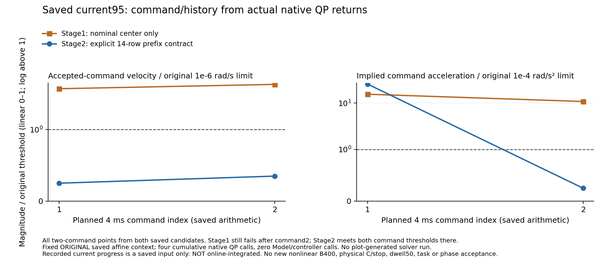
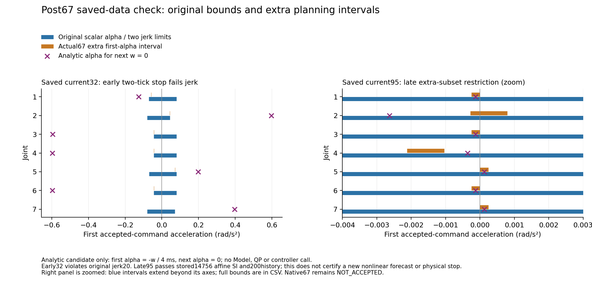

# Post67 saved command/history study: retained negative stopping result

## Distinct stage2: saved command/history contract passes after two commands

[Independent actual native review, exact scope/helper/source and small vectors](ROOT_STAGE2_ACTUAL_NATIVE_REVIEW.json), [candidate-only compiled source](../../../tools/post67_saved_history_prefix_v1/saved_prefix_native_stage2.cpp). A distinct180s stage uses only current95 and one additional candidate-only native call: four saved native calls total, zero Model/controller68. It does not restart the completed600s first stage or rerun a baseline. Fourteen existing extra-alpha rows6967..6980 intersect the first stage’s bounds; every other row/matrix remains unchanged. First-command target is|w1|<=.25e-6, second-alpha<=2.5e-5, implying|w2|<=.35e-6. The actual returned solution independently satisfies these values and original14756SI(max1.0000000000540735e-13)/strict7/140alpha/200history/400progress.

| Returned command | w infinity norm (rad/s) | implied alpha infinity norm (rad/s²) | Both original command-stop thresholds? |
| --- | ---: | ---: | --- |
| First | 2.492633441132223e-7 | .002567815993993643 | No |
| Second | 3.485249291547167e-7 | 2.4815396260373593e-5 | Yes, in this fixed saved context |

This is a command/history result only: no new genuine forecast, nonlinear B400, physical C/stop,50-observation dwell or online integration is tested. The saved prototype still uses recorded current native progress and remains NOT_INTEGRATED/NOT_RELEASED. Early32 rejection and stage1’s5.047672e-6 velocity failure are retained. Two stage2 startup attempts reject incorrect driver/dependency path identities before any compiler/linker/QP; attempt3 fixes only the exact bindings and actually performs one compile/link.1878 inputs remain byte-identical; the one candidate call and collection finish before the new absolute deadline. Neither input rejection is bypassed or erased.

[SVG](../../../figures/post67_stage2_saved_native_contract_20261016.svg), [all four plotted command points](../../../figures/post67_stage2_saved_native_contract_20261016.csv), [renderer, vectors binding and provenance](../../../figures/post67_stage2_saved_native_contract_20261016.json). Root visually inspected the complete figure; the first-step acceleration remains above stop even in stage2, and the old candidate failure remains visible. No executed motion or physical stopping is depicted.

Stage2 Mac recovery archive `transfer/cold-backups/post67-saved-prefix-stage2-v1-20261016/complete_stage2.tar.gz`:726378B,SHA `ee70f229541289825777280334c4a632b169794ffc2eb2743f9990b5bf475b08`,43members, actual persisted reopened SHA/CRC/singleEOF and all members checked. It includes new sidecar, actual source/protocol/vectors and both startup failures; object/dependency caches are excluded. Unchanged fixture inputs are bound to stage1 recovery `d615ff...` and complete67. Separate stage2 ELF19,836,960B,SHA `b68cdea67207a1b80ebfc11d10725a861582bb148e0670b1e360f53bea924646`, reserved24MiB, Mac fsync/reopen hash verified and never executed on Mac; original Dell source/input/output/ELF remain. No standalone environment claim.

The saved native budget4/4 is now consumed. Both stages are closed, not extended. Next functional work must replace recorded-current progress with a causally available independent progress nominal, integrate the prefix into the genuine forecast path and requalify original nonlinear/physical/stop checks with fresh finite scope/resources. Actual68 is not entered. Phase5 NOT_ACCEPTED; Phase6 NOT_STARTED.

The closed first stage consumes1compile/1link and3saved native QP calls inside its original600s, using only actual67 current32/95.1878 build inputs stay byte-identical. No Model or controller68 call occurs; no physical stop or full-task/phase success is claimed.

[Complete source/build/native vector/result and recovery packet](STAGE1_RESULT_SOURCE_AND_RECOVERY.json), [Root independent actual-native review](ROOT_ACTUAL_NATIVE_REVIEW.json), [Root early/late analytic precheck](ROOT_TWO_SAVED_PREFIX_PRECHECK.json), [exact saved-only source](../../../tools/post67_saved_history_prefix_v1/README.md), [all-inclusive allocation/helper](ALLOCATION_AND_HELPER.json). Both true-hint baselines reproduce original144x/dynamic-y/160U byte-for-byte. Early32 two-tick stopping violates original jerk20 and is refused (no early candidate QP).

Late95 changes135 bounds within the declared140 extra-alpha rows; all original base,140jointjerk,20progress and264floor rows, H/g/A/F/E and native tolerances remain. The candidate passes original14756SI(max1.0000000001864224e-13), strict7/140alpha and200history/400positive progress. Native residuals are about1e-15. Nevertheless its first/second command velocity norms are4.320562e-6 and5.047672e-6 (limit1e-6), with implied acceleration.001549989/.001080327 (limit1e-4). Both command stopping conditions fail, including a second-step velocity rebound. A smaller feasible planning subset and shifted nominal center alone do not enforce two-step stopping.

The current recorded candidate progress is available for the saved-data prototype only; using it to generate the same cycle’s online nominal would be circular. The prototype is **NOT_INTEGRATED/NOT_RELEASED**. New genuine forecast/nonlinear B400/physical C are not run. Root’s initial readback assertion wrongly required all140 allowed rows to change; the preserved V2 records the135 actual changed rows and confirms every change lies inside that set. No extra native/Model call occurs for this reader correction.

[SVG](../../../figures/post67_saved_prefix_constraints_v2_20261016.svg), [all14joint/context rows](../../../figures/post67_saved_prefix_constraints_v2_20261016.csv), [renderer/provenance](../../../figures/post67_saved_prefix_constraints_v2_20261016.json). Root visually checked the figure, with explicit right-panel zoom and blue interval continuation. Initial V1 images/source are retained. These show saved analytic constraints, not executed candidate motion.

Mac recovery: `transfer/cold-backups/post67-saved-prefix-stage1-v1-20261016/complete_saved_stage.tar.gz`,8,902,782B,SHA `d615ff225cae7cb4f9c3e67b77fbd9d454397609819dfefe5cded2607d1264d3`;53members/25,240,439payload bytes, every member and actual persisted whole SHA/CRC/single EOF verified. The separate19,837,168B ELF SHA is `0cffcd1a5ea4c5b39b7b6ce9b29ca19e1bdb31b4b326542520109d4cfb17e7b6`, reserved24MiB and readback-verified, never executed on Mac. New fixed fixtures/source/vectors remain in original Dell D saved64/build96 roots, verified with source identities; original complete67 archive binds full input contexts. Dependencies/build caches remain excluded; no standalone environment restoration claim. No evidence is deleted.

The old10000-output ledger stays closed with SHA94dfdbefb227627e30efb8f35ad946712856ca352462cbf1e48ae39405a876f9. The new all-Mac128items/128MiB allocation counts source, failures, ELF, archive, public figures and standing control metadata; at least24records remain reserved. A distinct stage2 may examine explicit intersections for first-two-step command contraction, but does not reset or extend this completed600s stage. Real68 still needs original readiness and actual disk headroom. Phase5 NOT_ACCEPTED; Phase6 NOT_STARTED.
